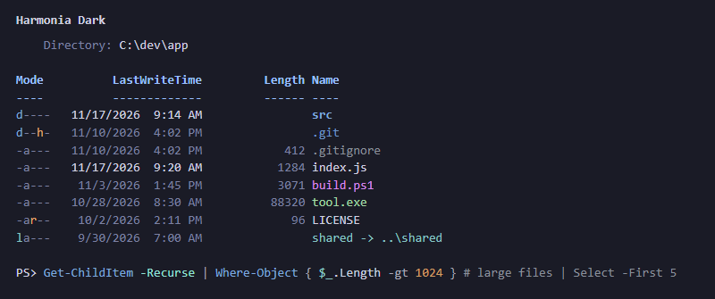
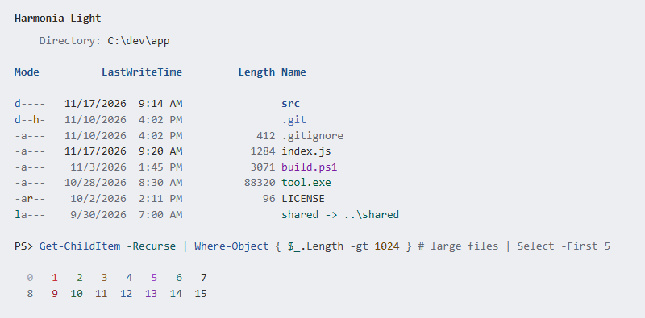
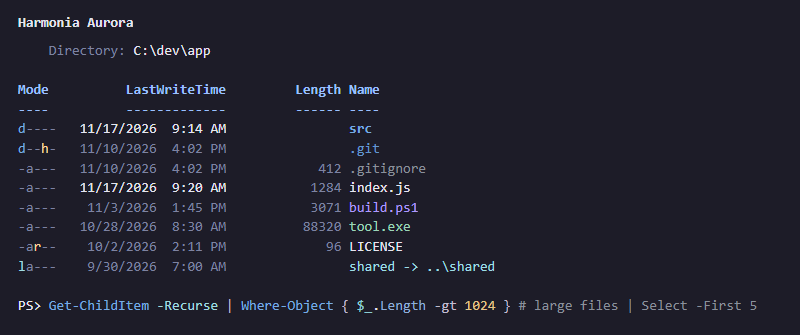
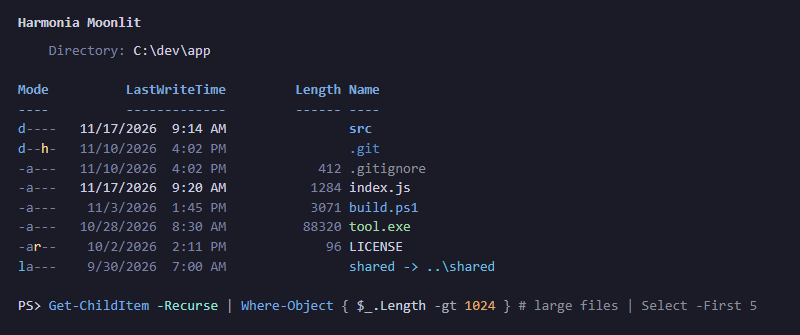
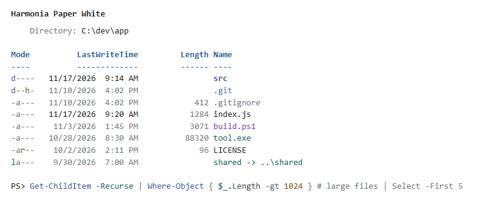
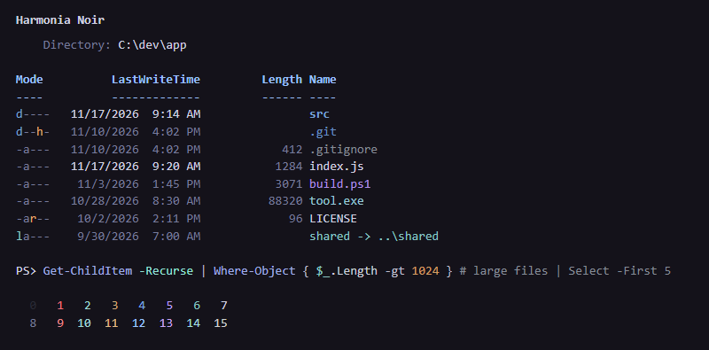
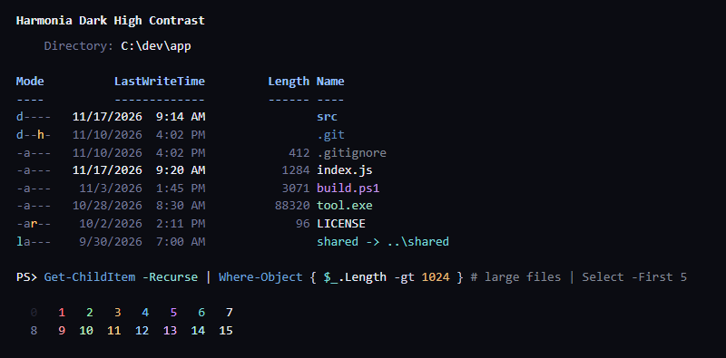

# harmonia-terminal

Converts the [Harmonia](https://github.com/AgusRdz/harmonia-theme) VS Code theme into color schemes for Windows Terminal, Ghostty, iTerm2, WezTerm, Kitty and Alacritty, Herdr themes and PowerShell color scripts. All nine variants are generated from harmonia-theme's published theme JSON, then tuned for long terminal sessions (see [Contrast](#contrast)).

## Variants

| | |
|---|---|
|  |  |
|  |  |
|  |  |
|  |  |
|  | |

## Layers

1. **Windows Terminal color schemes** (`dist/windows-terminal/harmonia.json`): background, foreground, cursor, selection and the 16 ANSI colors, as a fragment extension.
2. **Herdr themes** (`dist/herdr/harmonia-<variant>.json`): the same terminal colors plus panel colors (sidebar, borders, hover and selection, menus, primary button, agent status) mapped from the editor UI. Herdr derives whatever is not mapped.
3. **PSReadLine colors** (`dist/powershell/harmonia-<variant>.ps1`): syntax highlighting while typing, predictions and selection.
4. **`$PSStyle` colors** (same script, PowerShell 7.2+): table headers, errors, warnings, progress, file listings.
5. **`Get-ChildItem` format** (`dist/powershell/harmonia-<variant>.format.ps1xml`, PowerShell 7.2+): the default table view with brightness hierarchy instead of more hues. Names carry the color, metadata (mode, size, older timestamps) is dim, and flags such as read-only or hidden get a single accent. The script loads it when `harmonia.format.ps1xml` sits next to it.
6. **Ghostty themes** (`dist/ghostty/harmonia-<variant>`): background, foreground, cursor, selection and the 16 ANSI colors.
7. **iTerm2 color presets** (`dist/iterm2/harmonia-<variant>.itermcolors`): background, foreground, cursor, selection and the 16 ANSI colors.
8. **WezTerm color schemes** (`dist/wezterm/harmonia-<variant>.toml`): background, foreground, cursor, selection and the 16 ANSI colors.
9. **Kitty themes** (`dist/kitty/harmonia-<variant>.conf`): background, foreground, cursor, selection and the 16 ANSI colors.
10. **Alacritty themes** (`dist/alacritty/harmonia-<variant>.toml`): background, foreground, cursor, selection and the 16 ANSI colors.
11. **oh-my-posh prompt** (`oh-my-posh/harmonia.omp.json`): user, path, git branch, and exit code on failure. It uses ANSI color names instead of hex, so it follows whichever Harmonia scheme Windows Terminal is using; one file covers every variant. Segment text is drawn in the terminal background color (`transparent`), so its contrast equals the segment color's contrast against the background, which the ANSI rules below keep at 4.5:1 or more.

The PowerShell scripts work in PowerShell 7 and Windows PowerShell 5.1; settings the running version does not support are skipped.

## Install

Without cloning, run the install script straight from GitHub. It downloads the repo into a temporary folder, installs from there, and deletes it.

Every run installs all nine variants. The variant you pass only matters where a single variant has to be active (see [Windows](#windows) and [macOS and Linux](#macos-and-linux)); without one, `harmonia-dark` is used.

```sh
# macOS and Linux: all nine variants, instructions for harmonia-dark
curl -fsSL https://raw.githubusercontent.com/AgusRdz/harmonia-terminal/main/install.sh | bash

# Same, with the instructions for another variant
curl -fsSL https://raw.githubusercontent.com/AgusRdz/harmonia-terminal/main/install.sh | bash -s -- harmonia-aurora
```

```powershell
# Windows: all nine Windows Terminal and Herdr schemes, PowerShell colors for harmonia-dark
& ([scriptblock]::Create((irm https://raw.githubusercontent.com/AgusRdz/harmonia-terminal/main/install.ps1)))

# Same, with PowerShell colors for another variant
& ([scriptblock]::Create((irm https://raw.githubusercontent.com/AgusRdz/harmonia-terminal/main/install.ps1))) -Variant harmonia-aurora
```

To uninstall without a clone (no variant needed):

```sh
# macOS and Linux
curl -fsSL https://raw.githubusercontent.com/AgusRdz/harmonia-terminal/main/uninstall.sh | bash
```

```powershell
# Windows
& ([scriptblock]::Create((irm https://raw.githubusercontent.com/AgusRdz/harmonia-terminal/main/uninstall.ps1)))
```

Read a script before piping it into a shell; they are short. Run the install command again to update.

To use the scripts from a clone, or to install by hand, clone the repo. The themes are already built in `dist/`, so there is nothing to compile.

```sh
git clone https://github.com/AgusRdz/harmonia-terminal.git
cd harmonia-terminal
```

Every terminal gets all nine variants at once, and you pick one in its settings: `harmonia-dark`, `harmonia-light`, `harmonia-aurora`, `harmonia-daybreak`, `harmonia-moonlit`, `harmonia-paper-white`, `harmonia-noir`, `harmonia-dark-high-contrast`, `harmonia-oled-true-black`. WezTerm and Kitty list them by display name (`Harmonia Dark`). The PowerShell colors are the exception: they hold one variant at a time.

### Windows

```powershell
.\install.ps1                            # PowerShell colors for harmonia-dark
.\install.ps1 -Variant harmonia-aurora   # PowerShell colors for harmonia-aurora
```

Either way, Windows Terminal and Herdr get all nine schemes. `-Variant` only picks the PowerShell colors (PSReadLine, `$PSStyle`, `Get-ChildItem`), because a profile can load one at a time. It copies the fragment to `%LOCALAPPDATA%\Microsoft\Windows Terminal\Fragments\Harmonia\`, copies the chosen script to `~\.config\harmonia\harmonia.ps1` and its format file to `harmonia.format.ps1xml` beside it, copies the oh-my-posh theme to `~\.config\harmonia\harmonia.omp.json`, and prints the lines to add to `$PROFILE`. If `~\.config\herdr-app` exists it also copies all nine Herdr themes to its `themes\` folder. It does not edit your profile.

```powershell
.\uninstall.ps1
```

It removes the fragment, the files in `~\.config\harmonia\` and the Herdr themes this repo ships, then lists the lines in your PowerShell profiles and Windows Terminal settings that still point at Harmonia. It does not edit them.

PSReadLine and `Get-ChildItem` colors are baked per variant, so when you switch the Windows Terminal scheme, run the script again with the matching `-Variant`. Normal text uses the terminal's default foreground, so nothing turns unreadable in the meantime.

Manual:

1. Copy `dist/windows-terminal/harmonia.json` into the Fragments folder above.
2. Copy a `dist/powershell/harmonia-<variant>.ps1` somewhere stable, copy the matching `.format.ps1xml` next to it as `harmonia.format.ps1xml`, and add `. "<path>"` to `$PROFILE`.
3. Restart Windows Terminal and select a Harmonia scheme in the profile's Appearance settings.
4. For Herdr, copy `dist/herdr/*.json` into `~/.config/herdr-app/themes/` and pick a `harmonia-*` theme in its Settings. A layout can pair them with `"theme": { "light": "harmonia-light", "dark": "harmonia-dark" }`.
5. For Alacritty, copy `dist/alacritty/*.toml` into `%APPDATA%\alacritty\themes\` and add `import = ["<themes folder>/harmonia-dark.toml"]` under `[general]` in `alacritty.toml`.

### macOS and Linux

```sh
./install.sh                    # instructions for harmonia-dark
./install.sh harmonia-aurora    # instructions for harmonia-aurora
```

Either way, every terminal gets all nine variants. The variant only changes the `todo` lines it prints (the theme name to put in each config), so you can switch later in each terminal's config without running it again. For each of Ghostty, iTerm2 (macOS), WezTerm, Kitty, Alacritty and Herdr that it finds, it:

- copies all nine themes and checks each copy against `dist/`;
- for iTerm2, writes the nine color presets by name, so running it again updates them instead of adding copies;
- for Kitty, refreshes `current-theme.conf` if `kitten themes` saved a Harmonia theme there;
- for Ghostty, runs `ghostty +validate-config`;
- reports `ok` when the terminal's config already uses Harmonia, or `todo` with the exact line to add. It does not edit your config files.

Run it again after pulling an update, then reload each terminal. It exits with an error if any check fails.

```sh
./uninstall.sh
```

It removes only the files this repo ships and every `harmonia-*` iTerm2 preset, then lists the config lines that still point at Harmonia so you can change them.

Manual:

```sh
# Ghostty: themes are only read from ~/.config/ghostty/themes, even when the
# config file lives in ~/Library/Application Support/com.mitchellh.ghostty/config
mkdir -p ~/.config/ghostty/themes && cp dist/ghostty/* ~/.config/ghostty/themes/
mkdir -p ~/.config/wezterm/colors && cp dist/wezterm/*.toml ~/.config/wezterm/colors/
mkdir -p ~/.config/kitty/themes && cp dist/kitty/*.conf ~/.config/kitty/themes/
mkdir -p ~/.config/alacritty/themes && cp dist/alacritty/*.toml ~/.config/alacritty/themes/
mkdir -p ~/.config/herdr-app/themes && cp dist/herdr/*.json ~/.config/herdr-app/themes/
```

Then select a variant and reload:

| Terminal | Select | Reload |
|---|---|---|
| Ghostty | `theme = harmonia-dark` in the config (Ghostty > Settings…). `theme = light:harmonia-light,dark:harmonia-dark` follows the system appearance. | `Cmd+Shift+,` |
| iTerm2 | `open dist/iterm2/harmonia-dark.itermcolors`, then pick it in Settings > Profiles > Colors > Color Presets. Opening the same file again adds a copy (`harmonia-dark (2)`); the script avoids that. | Pick the preset again; profiles keep a copy of the colors |
| WezTerm | `config.color_scheme = 'Harmonia Dark'` in `~/.wezterm.lua` | `Cmd+R`, or reopen |
| Kitty | `kitten themes`, User category. It saves a copy in `current-theme.conf`, so run it again after an update. Or `include themes/harmonia-dark.conf` in `kitty.conf`. | `Ctrl+Cmd+,` |
| Alacritty | `import = ["~/.config/alacritty/themes/harmonia-dark.toml"]` under `[general]` in `~/.config/alacritty/alacritty.toml` | Reopen |
| Herdr | A `harmonia-*` theme in its Settings | |

### Check

Print the 16 ANSI colors as text and compare them with the variant's screenshot. Color 0 (black) is meant to be nearly invisible on the background; it is used as a fill.

```sh
for i in {0..15}; do printf '\e[38;5;%sm%3s ' $i $i; [ $i = 7 ] && echo; done; printf '\e[0m\n'
```

## Contrast

Every variant follows the same three-tier hierarchy, measured with WCAG contrast against the variant's background:

| Tier | What | Contrast |
|---|---|---|
| Normal | file names, today's timestamps, typed text | terminal default foreground |
| Accent | folders, flags, links, executables, scripts, table headers, syntax tokens | at least 7:1 (AAA) |
| Quiet | mode, size, older timestamps, dotfiles, dot-folders, comments, predictions | 4.5:1 to 5.5:1 (AA, kept below accents) |

Colors that miss their tier are moved along OKLCH lightness, keeping their hue, so a few accents in the light variants are darker than in the editor. `npm run build` fails if any generated foreground drops below 4.5:1.

The 16 ANSI colors follow the same rule against the background. Bright black is the usual dim text color (autosuggestions, comments), so it sits in the quiet tier. The other chromatic colors are also used as fills (prompt segments), so they only need AA, not 7:1. No color, bright white included, has more contrast than normal text, so bright colors never glare above the foreground. Black and white are left as designed, and the selection background is moved if the foreground would fall below 4.5:1 on it. The Ghostty, iTerm2, WezTerm, Kitty and Alacritty themes use the same adjusted palette. Herdr's `muted` and `dim` use the quiet tier; its accent and agent status colors, which render as text, use the accent tier.

## Troubleshooting

If PowerShell 7 starts with `Cannot load PSReadline module`, run `.\check-psreadline.ps1`. It reports, without changing anything, whether PSReadLine's Microsoft signing certificate is in your `CurrentUser\Disallowed` store (usually from answering `[V] Never run` at a publisher prompt). If it is, `.\fix-psreadline.ps1` backs the certificate up, removes it, and verifies PSReadLine loads; `.\fix-psreadline.ps1 -Undo` restores it. Machine-level or Group Policy entries are left alone.

## Update

Bump the pinned commit of `harmonia-theme` in `package.json`, then:

```
npm install
npm run build
npm run preview
.\scripts\screenshots.ps1
```

`npm run preview` writes `docs/preview.html` with every variant side by side; `scripts/screenshots.ps1` captures one image per variant into `docs/images/` using headless Edge. The `dist/` output is committed.
