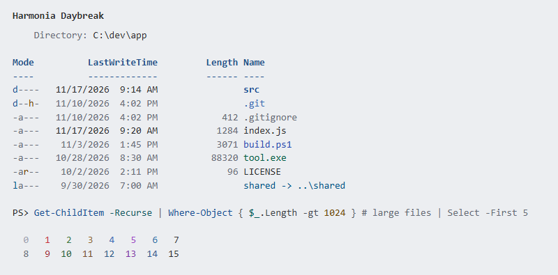

# harmonia-terminal

Converts the [Harmonia](https://github.com/AgusRdz/harmonia-theme) VS Code theme into color schemes for Windows Terminal, Ghostty, iTerm2, WezTerm, Kitty and Alacritty, Herdr themes and PowerShell color scripts. All nine variants are generated from harmonia-theme's published theme JSON, then tuned for long terminal sessions (see [Contrast](#contrast)).

## Variants

| | |
|---|---|
|  |  |
|  |  |
|  |  |
|  |  |
|  | |

## Layers

1. **Windows Terminal color schemes** (`dist/windows-terminal/harmonia.json`): background, foreground, cursor, selection and the 16 ANSI colors, as a fragment extension.
2. **Herdr themes** (`dist/herdr/harmonia-<variant>.json`): the same terminal colors plus panel colors (sidebar, borders, hover and selection, menus, primary button, agent status) mapped from the editor UI. Herdr derives whatever is not mapped.
3. **PSReadLine colors** (`dist/powershell/harmonia-<variant>.ps1`): syntax highlighting while typing, predictions and selection.
4. **`$PSStyle` colors** (same script, PowerShell 7.2+): table headers, errors, warnings, progress, file listings.
5. **`Get-ChildItem` format** (`dist/powershell/harmonia-<variant>.format.ps1xml`, PowerShell 7.2+): the default table view with brightness hierarchy instead of more hues. Names carry the color, metadata (mode, size, older timestamps) is dim, and flags such as read-only or hidden get a single accent. The script loads it when `harmonia.format.ps1xml` sits next to it.
6. **Ghostty themes** (`dist/ghostty/harmonia-<variant>`): background, foreground, cursor, selection and the 16 ANSI colors.
7. **iTerm2 color presets** (`dist/iterm2/harmonia-<variant>.itermcolors`): background, foreground, cursor, selection and the 16 ANSI colors.
8. **WezTerm color schemes** (`dist/wezterm/harmonia-<variant>.toml`): background, foreground, cursor, selection and the 16 ANSI colors.
9. **Kitty themes** (`dist/kitty/harmonia-<variant>.conf`): background, foreground, cursor, selection and the 16 ANSI colors.
10. **Alacritty themes** (`dist/alacritty/harmonia-<variant>.toml`): background, foreground, cursor, selection and the 16 ANSI colors.
11. **oh-my-posh prompt** (`oh-my-posh/harmonia.omp.json`): user, path, git branch, and exit code on failure. It uses ANSI color names instead of hex, so it follows whichever Harmonia scheme Windows Terminal is using; one file covers every variant. Segment text is drawn in the terminal background color (`transparent`), so its contrast equals the segment color's contrast against the background, which the ANSI rules below keep at 4.5:1 or more.

The PowerShell scripts work in PowerShell 7 and Windows PowerShell 5.1; settings the running version does not support are skipped.

## Install

Script:

```powershell
.\install.ps1 -Variant harmonia-dark
```

It copies the fragment to `%LOCALAPPDATA%\Microsoft\Windows Terminal\Fragments\Harmonia\`, copies the chosen script to `~\.config\harmonia\harmonia.ps1` and its format file to `harmonia.format.ps1xml` beside it, copies the oh-my-posh theme to `~\.config\harmonia\harmonia.omp.json`, and prints the lines to add to `$PROFILE`. If `~\.config\herdr-app` exists it also copies all nine Herdr themes to its `themes\` folder. It does not edit your profile.

Manual:

1. Copy `dist/windows-terminal/harmonia.json` into the Fragments folder above.
2. Copy a `dist/powershell/harmonia-<variant>.ps1` somewhere stable, copy the matching `.format.ps1xml` next to it as `harmonia.format.ps1xml`, and add `. "<path>"` to `$PROFILE`.
3. Restart Windows Terminal and select a Harmonia scheme in the profile's Appearance settings.
4. For Herdr, copy `dist/herdr/*.json` into `~/.config/herdr-app/themes/` and pick a `harmonia-*` theme in its Settings. A layout can pair them with `"theme": { "light": "harmonia-light", "dark": "harmonia-dark" }`.
5. For Ghostty, copy `dist/ghostty/*` into `~/.config/ghostty/themes/` and set `theme = harmonia-dark` (or `theme = light:harmonia-light,dark:harmonia-dark`).
6. For iTerm2, import a `dist/iterm2/*.itermcolors` in Settings > Profiles > Colors > Color Presets > Import, then pick it from the same menu.
7. For WezTerm, copy `dist/wezterm/*.toml` into `~/.config/wezterm/colors/` and set `config.color_scheme = 'Harmonia Dark'` (the scheme name inside the file).
8. For Kitty, copy `dist/kitty/*.conf` into `~/.config/kitty/themes/`, then run `kitten themes` or add `include themes/harmonia-dark.conf` to `kitty.conf`.
9. For Alacritty, copy `dist/alacritty/*.toml` into `~/.config/alacritty/themes/` (Windows: `%APPDATA%\alacritty\themes\`) and add `import = ["<themes folder>/harmonia-dark.toml"]` under `[general]` in `alacritty.toml`.

PSReadLine and `Get-ChildItem` colors are baked per variant, so when you switch the Windows Terminal scheme, reinstall the matching variant too. Normal text uses the terminal's default foreground, so nothing turns unreadable in the meantime.

## Contrast

Every variant follows the same three-tier hierarchy, measured with WCAG contrast against the variant's background:

| Tier | What | Contrast |
|---|---|---|
| Normal | file names, today's timestamps, typed text | terminal default foreground |
| Accent | folders, flags, links, executables, scripts, table headers, syntax tokens | at least 7:1 (AAA) |
| Quiet | mode, size, older timestamps, dotfiles, dot-folders, comments, predictions | 4.5:1 to 5.5:1 (AA, kept below accents) |

Colors that miss their tier are moved along OKLCH lightness, keeping their hue, so a few accents in the light variants are darker than in the editor. `npm run build` fails if any generated foreground drops below 4.5:1.

The 16 ANSI colors follow the same rule against the background. Bright black is the usual dim text color (autosuggestions, comments), so it sits in the quiet tier. The other chromatic colors are also used as fills (prompt segments), so they only need AA, not 7:1. Black, white and bright white are left as designed, and the selection background is moved if the foreground would fall below 4.5:1 on it. The Ghostty, iTerm2, WezTerm, Kitty and Alacritty themes use the same adjusted palette. Herdr's `muted` and `dim` use the quiet tier; its accent and agent status colors, which render as text, use the accent tier.

## Troubleshooting

If PowerShell 7 starts with `Cannot load PSReadline module`, run `.\check-psreadline.ps1`. It reports, without changing anything, whether PSReadLine's Microsoft signing certificate is in your `CurrentUser\Disallowed` store (usually from answering `[V] Never run` at a publisher prompt). If it is, `.\fix-psreadline.ps1` backs the certificate up, removes it, and verifies PSReadLine loads; `.\fix-psreadline.ps1 -Undo` restores it. Machine-level or Group Policy entries are left alone.

## Update

Bump the pinned commit of `harmonia-theme` in `package.json`, then:

```
npm install
npm run build
npm run preview
.\scripts\screenshots.ps1
```

`npm run preview` writes `docs/preview.html` with every variant side by side; `scripts/screenshots.ps1` captures one image per variant into `docs/images/` using headless Edge. The `dist/` output is committed.
